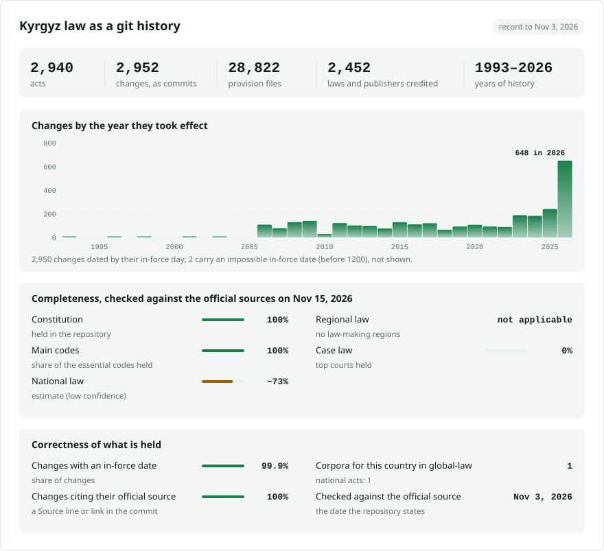

# Kyrgyzstan: law history in git

[Русский](README.md) · **English**

<picture>
<source media="(prefers-color-scheme: dark)" srcset="data/effort-dark.svg">

</picture>

The law of the Kyrgyz Republic as a git history: one file per article, one commit per version on the day it took effect, and the law that made each change as the commit's author (the publisher, where no law is named). `git blame` names the law behind every line; `git log` lists every change to an article; picking a date gives the text in force that day.

Part of [lexifina/global-law](https://github.com/lexifina/global-law), one git history for every country's law: this is Kyrgyzstan's national law, which global-law reads at `kyrgyzstan/national/acts/`.

**What is in it now:** the Constitution of 5 May 1993 in all nine editions the Ministry of Justice publishes, changed by seven laws from 1996 to 2007, until the Constitution of 2010 replaced it on 2 July 2010; the Constitution of 5 May 2021, in force from that day; and 2,938 codes and laws the database lists as in force (22 codes, 56 constitutional laws and 2,860 laws), each as its current text only. [`zakony.csv`](zakony.csv) lists the laws that changed the Constitutions, with their dates; [`REPRODUCE-acts.md`](REPRODUCE-acts.md) lists every code and law.

Laws are in `<kind>/<year>/<month>-<day>-n<number>/`, by the day they were enacted (`zakon/2009/02-09-n43/` is the Закон КР of 9 February 2009 No. 43, on universal military duty; `konst-zakon/` holds constitutional laws); the codes have folders named after them (`trudovoy-kodeks-kyrgyzskoy-respubliki/` is the Трудовой кодекс, the Labour Code, Code No. 23 of 23 January 2025). The 2021 Constitution is `act/2021/konstitutsiya/`; the 1993 Constitution's files are under `konstitutsiya-1993/` until 2 July 2010. Each article is one file, `statya-NNN.md`, and `data/paths.json` maps each act id to its folder.

The text is in Russian, an official language, as the Ministry of Justice database publishes it. Kyrgyz is the state language; the database's Kyrgyz text and any English translation are not part of this record.

## Questions as git commands

| Question | Command |
| --- | --- |
| Every change to Article 5 of the 1993 Constitution (languages) | `git log -p --word-diff -- konstitutsiya-1993/statya-005.md` |
| Which law wrote each line of Article 44 of the 2021 Constitution? | `git blame act/2021/konstitutsiya/statya-044.md` |
| Every version of the 1993 Constitution, with the day each took effect | `git log --format="%h %(trailers:key=In-force,valueonly,separator=) %an" -- konstitutsiya-1993 ":(exclude)konstitutsiya-1993/README.md"` |
| Article 5 of the 1993 Constitution as in force on 1 January 2002 | `python tools/on.py 2002-01-01 konstitutsiya-1993 5` |

**Outside git**, we also host this record publicly, for free:

- **[Ask Claude about the law of Kyrgyzstan](https://global-law.lexifina.com/v1/try_claude?country=kyrgyzstan)**: opens Claude with a first question ready.
- **[Ask ChatGPT](https://global-law.lexifina.com/v1/try_chatgpt?country=kyrgyzstan)**: the same question in ChatGPT.
- **[Search Kyrgyzstan's law on our site](https://lexifina.com/law?country=kyrgyzstan&q=%D0%B5%D0%B6%D0%B5%D0%B3%D0%BE%D0%B4%D0%BD%D1%8B%D0%B9+%D0%BE%D1%82%D0%BF%D1%83%D1%81%D0%BA)**: a search for "ежегодный отпуск" (annual leave), with each provision's text and its versions, no account needed.
- **[Developer REST API](https://global-law.lexifina.com/v1/search_law?query=%D0%B5%D0%B6%D0%B5%D0%B3%D0%BE%D0%B4%D0%BD%D1%8B%D0%B9+%D0%BE%D1%82%D0%BF%D1%83%D1%81%D0%BA&jurisdiction=kyrgyzstan)**: the same search as JSON, with no key. See the [documentation here](https://lexifina.com/api/global-law).

Both assistants read the record through the free Global law connector (MCP, `https://global-law.lexifina.com/mcp`); the first time, the chat gives you the link that adds it. Ask in Russian or in English.

**Host it yourself easily.** All it takes is git and Python, and the tools run on your machine:

```sh
git clone --depth 1 https://github.com/lexifina/global-law && cd global-law
python3 tools/countries.py add kyrgyzstan/national/acts
python3 tools/law.py show 2026-01-01 kyrgyzstan/national/acts/act/2021/konstitutsiya/statya-044.md
```

Opened in Claude Code, Cursor, VS Code or Codex, the clone also starts a local MCP server with the same tools ([MCP.md](https://github.com/lexifina/global-law/blob/main/MCP.md)).

## Dates

Each commit is dated at noon, Asia/Bishkek, on the day the version took effect, and carries it in its `In-force:` trailer:

- for the Constitutions, the day each law took effect by its own words ("со дня официального опубликования", "со дня подписания"), quoted in the commit's `Evidence:` trailer; part 2 of Article 44 of the 2021 Constitution has its own commit on 1 January 2023;
- for a code or law never amended (2,440 of them), the day it took effect by its own words, else the database's entry-into-force day, else its day of enactment; the commit's message says which;
- for an amended code or law (498), 3 November 2026, the day its current text was retrieved: the commit does not say that this wording applied any earlier;
- two laws of 2025 whose database record gives the year as 0025 and 0202 are dated 1 January 1970, as git stores no earlier date, with the database's day in `In-force:`.

A change to a Constitution is credited to the law that made it, as the database names it (`Закон КР от 16 февраля 1996 года № 1`); the changes no law names (three commits: the database's corrections of spelling and punctuation) are credited to the publisher, `ЦБД ПИ Минюста КР`, as `Kind: unexplained`. A code or law never amended is credited to itself, an amended one to the publisher.

## How it is checked

- `tools/check_repo.py` reads every edition of the Constitutions back from git on the day it took effect and compares it with the edition, file by file byte for byte and the whole act word for word: 913 files, no mismatches.
- A second build of the Constitutions from the same data gave the same hashes for every commit and tag. Both results are in [`REPRODUCE.md`](REPRODUCE.md).
- `tools/check_acts.py` reads every code and law back from git and compares it with the corpus it was built from ([`REPRODUCE-acts.md`](REPRODUCE-acts.md)).
- History is append-only: new acts and versions go on top (`tools/append.py`), and no published commit is rewritten.
- [vulnerabilities/](vulnerabilities/README.en.md): possible drafting mistakes in Kyrgyz law, found by global-law's detectors and checked by hand.

## What it does not show

- **Earlier wording of the codes and laws.** Only the Constitutions have their history; the 498 amended codes and laws begin on 3 November 2026, so `git blame` names the publisher, not the amending law.
- **The Constitution of 2010** and its amendments: between 2 July 2010 and 5 May 2021 the record holds no Constitution.
- **Laws no longer in force**, presidential decrees, government resolutions, case law and local acts.
- **The database's notes**: its bracketed editorial notes ("(В редакции ...)", "(Утратила силу ...)") and status banners are not in the files.
- **The Kyrgyz text.**

## Sources

| Source | Kind | Past versions | Notes |
| --- | --- | --- | --- |
| [Централизованный банк данных правовой информации](https://cbd.minjust.gov.kg) (Ministry of Justice of the Kyrgyz Republic) | Official legal database | yes, an edition per amending law; all were read for the Constitutions, only the current one for the codes and laws | The Russian text of each edition, its day and the law that made it |

## Licence

See [`LICENSE`](LICENSE). Under the Kyrgyz law on copyright, official documents (laws, decisions and the like) are not objects of copyright (Закон КР "Об авторском праве и смежных правах", статья 8); the database publishes no terms of reuse. Lexifina's arrangement, commit messages, tables and tools are CC0 1.0.

No AI model wrote or changed legal text, and none runs when the history is built or checked; the scripts were written by Claude Code running Claude Opus 5.5 (see [`REPRODUCE.md`](REPRODUCE.md) and [`REPRODUCE-acts.md`](REPRODUCE-acts.md)).

## More

From [lexifina/global-law](https://github.com/lexifina/global-law):

- [FEATURES.md](https://github.com/lexifina/global-law/blob/main/FEATURES.md): every feature, and what every corpus must support (`git blame`, `law.py`, the MCP tools)
- [FAQ.md](https://github.com/lexifina/global-law/blob/main/FAQ.md): questions and answers · [CONTRIBUTING.md](https://github.com/lexifina/global-law/blob/main/CONTRIBUTING.md): proposing changes · [MCP.md](https://github.com/lexifina/global-law/blob/main/MCP.md): the MCP server · [REPRODUCE.md](https://github.com/lexifina/global-law/blob/main/REPRODUCE.md): how it was built · [CHANGELOG.md](https://github.com/lexifina/global-law/blob/main/CHANGELOG.md)
- [FRESHNESS.md](https://github.com/lexifina/global-law/blob/main/FRESHNESS.md): how current each corpus is · [Monitoring](https://github.com/lexifina/global-law/tree/main/monitoring): whether updates are running · [WATCHING.md](https://github.com/lexifina/global-law/blob/main/WATCHING.md): how each official source is watched for changes
- [performance/](https://github.com/lexifina/global-law/tree/main/performance): how fast the tools are, measured
- [visualisations/](https://github.com/lexifina/global-law/tree/main/visualisations): charts and bridges across the world's law
- [Vulnerabilities](https://github.com/lexifina/global-law/tree/main/vulnerabilities): mistakes in legislation as published
