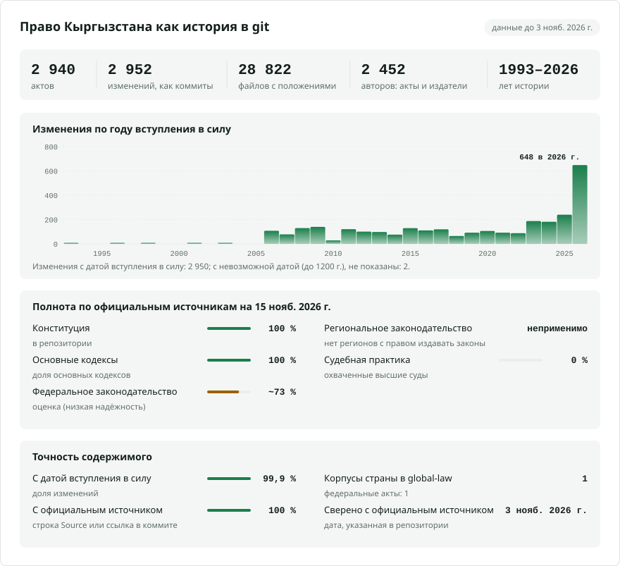

# Кыргызстан: история законодательства в git

**Русский** · [English](README.en.md)

<picture>
<source media="(prefers-color-scheme: dark)" srcset="data/ru/effort-dark.svg">

</picture>

Законодательство Кыргызской Республики в виде истории git: один файл на каждую статью, один коммит на каждую редакцию в день её вступления в силу, а автором коммита указан закон, внёсший изменение (публикатор, если закон не назван). `git blame` называет закон, стоящий за каждой строкой; `git log` перечисляет все изменения статьи; выбрав дату, можно получить текст, действовавший в тот день.

Часть [lexifina/global-law](https://github.com/lexifina/global-law) — единой истории git для законодательства всех стран: здесь национальное законодательство Кыргызстана, которое global-law читает по пути `kyrgyzstan/national/acts/`.

**Что здесь сейчас:** Конституция от 5 мая 1993 года во всех девяти редакциях, которые публикует Министерство юстиции, с изменениями, внесёнными семью законами с 1996 по 2007 год, — до её замены Конституцией 2010 года 2 июля 2010 года; Конституция от 5 мая 2021 года, действующая с этого дня; и 2 938 кодексов и законов, которые база данных указывает как действующие (22 кодекса, 56 конституционных законов и 2 860 законов), каждый только в текущей редакции. [`zakony.csv`](zakony.csv) перечисляет законы, изменявшие Конституции, с их датами; [`REPRODUCE-acts.md`](REPRODUCE-acts.md) перечисляет все кодексы и законы.

Законы находятся в папках `<kind>/<year>/<month>-<day>-n<number>/` по дню их принятия (`zakon/2009/02-09-n43/` — Закон КР от 9 февраля 2009 года № 43 о всеобщей воинской обязанности; в `konst-zakon/` находятся конституционные законы); у кодексов папки названы по их наименованию (`trudovoy-kodeks-kyrgyzskoy-respubliki/` — Трудовой кодекс Кыргызской Республики от 23 января 2025 года № 23). Конституция 2021 года находится в `act/2021/konstitutsiya/`; файлы Конституции 1993 года — в `konstitutsiya-1993/` до 2 июля 2010 года. Каждая статья — это один файл, `statya-NNN.md`, а `data/paths.json` сопоставляет идентификатор каждого акта с его папкой.

Текст приводится на русском языке, являющемся официальным, в том виде, в каком его публикует база данных Министерства юстиции. Государственным языком является кыргызский; текст базы данных на кыргызском языке и какой-либо перевод на английский в эту запись не входят.

## Вопросы в виде команд git

| Вопрос | Команда |
| --- | --- |
| Все изменения статьи 5 Конституции 1993 года (языки) | `git log -p --word-diff -- konstitutsiya-1993/statya-005.md` |
| Какой закон написал каждую строку статьи 44 Конституции 2021 года? | `git blame act/2021/konstitutsiya/statya-044.md` |
| Все редакции Конституции 1993 года с днём вступления в силу каждой из них | `git log --format="%h %(trailers:key=In-force,valueonly,separator=) %an" -- konstitutsiya-1993 ":(exclude)konstitutsiya-1993/README.md"` |
| Статья 5 Конституции 1993 года в редакции, действовавшей на 1 января 2002 года | `python tools/on.py 2002-01-01 konstitutsiya-1993 5` |

**Вне git** мы также бесплатно и открыто размещаем эту запись:

- **[Спросить Claude о законодательстве Кыргызстана](https://global-law.lexifina.com/v1/try_claude?country=kyrgyzstan)**: открывает Claude с уже подготовленным первым вопросом.
- **[Спросить ChatGPT](https://global-law.lexifina.com/v1/try_chatgpt?country=kyrgyzstan)**: тот же вопрос в ChatGPT.
- **[Искать в законодательстве Кыргызстана на нашем сайте](https://lexifina.com/law?country=kyrgyzstan&q=%D0%B5%D0%B6%D0%B5%D0%B3%D0%BE%D0%B4%D0%BD%D1%8B%D0%B9+%D0%BE%D1%82%D0%BF%D1%83%D1%81%D0%BA)**: поиск по запросу «ежегодный отпуск» с текстом каждого положения и его редакциями, без учётной записи.
- **[REST API для разработчиков](https://global-law.lexifina.com/v1/search_law?query=%D0%B5%D0%B6%D0%B5%D0%B3%D0%BE%D0%B4%D0%BD%D1%8B%D0%B9+%D0%BE%D1%82%D0%BF%D1%83%D1%81%D0%BA&jurisdiction=kyrgyzstan)**: тот же поиск в формате JSON, без ключа. См. [документацию здесь](https://lexifina.com/api/global-law).

Оба ассистента читают запись через бесплатный коннектор Global law (MCP, `https://global-law.lexifina.com/mcp`); при первом обращении чат даст ссылку для его подключения. Спрашивать можно на русском или на английском.

**Легко разместить у себя.** Нужны только git и Python, а инструменты работают на вашем компьютере:

```sh
git clone --depth 1 https://github.com/lexifina/global-law && cd global-law
python3 tools/countries.py add kyrgyzstan/national/acts
python3 tools/law.py show 2026-01-01 kyrgyzstan/national/acts/act/2021/konstitutsiya/statya-044.md
```

При открытии в Claude Code, Cursor, VS Code или Codex клон также запускает локальный MCP-сервер с теми же инструментами ([MCP.md](https://github.com/lexifina/global-law/blob/main/MCP.md)).

## Даты

Каждый коммит датирован полднем по времени Asia/Bishkek дня, в который редакция вступила в силу, и содержит этот день в трейлере `In-force:`:

- для Конституций — день вступления в силу каждого закона согласно его собственному тексту («со дня официального опубликования», «со дня подписания»), процитированному в трейлере `Evidence:` коммита; часть 2 статьи 44 Конституции 2021 года имеет собственный коммит от 1 января 2023 года;
- для кодекса или закона, ни разу не изменявшегося (таких 2 440), — день его вступления в силу согласно его собственному тексту, а при его отсутствии — день вступления в силу по базе данных, а при отсутствии и его — день принятия; в сообщении коммита указано, какой именно;
- для изменённого кодекса или закона (498) — 3 ноября 2026 года, день получения его текущего текста: коммит не утверждает, что эта редакция применялась раньше;
- два закона 2025 года, у которых в записи базы данных год указан как 0025 и 0202, датированы 1 января 1970 года, поскольку git не хранит более ранних дат, а день по базе данных указан в `In-force:`.

Изменение Конституции приписывается закону, который его внёс, под тем наименованием, которое даёт база данных (`Закон КР от 16 февраля 1996 года № 1`); изменения, не связанные ни с каким законом (три коммита: исправления орфографии и пунктуации в базе данных), приписываются публикатору, `ЦБД ПИ Минюста КР`, с пометкой `Kind: unexplained`. Ни разу не изменявшийся кодекс или закон приписывается самому себе, изменённый — публикатору.

## Как это проверяется

- `tools/check_repo.py` считывает каждую редакцию Конституций из git на день её вступления в силу и сравнивает с этой редакцией: пофайлово байт в байт и весь акт пословно: 913 файлов, расхождений нет.
- Повторная сборка Конституций из тех же данных дала те же хеши для каждого коммита и тега. Оба результата приведены в [`REPRODUCE.md`](REPRODUCE.md).
- `tools/check_acts.py` считывает каждый кодекс и закон из git и сравнивает с корпусом, из которого он построен ([`REPRODUCE-acts.md`](REPRODUCE-acts.md)).
- История только дополняется: новые акты и редакции добавляются сверху (`tools/append.py`), и ни один опубликованный коммит не переписывается.
- [vulnerabilities/](vulnerabilities/): возможные ошибки в законодательстве Кыргызстана, найденные детекторами global-law и проверенные вручную.

## Чего здесь нет

- **Прежних редакций кодексов и законов.** История есть только у Конституций; 498 изменённых кодексов и законов начинаются с 3 ноября 2026 года, поэтому `git blame` называет публикатора, а не изменяющий закон.
- **Конституции 2010 года** и изменений к ней: с 2 июля 2010 года по 5 мая 2021 года Конституции в записи нет.
- **Утративших силу законов**, указов Президента, постановлений Правительства, судебной практики и местных актов.
- **Примечаний базы данных**: её редакционные примечания в скобках («(В редакции ...)», «(Утратила силу ...)») и отметки о статусе в файлы не включены.
- **Текста на кыргызском языке.**

## Источники

| Источник | Вид | Прежние редакции | Примечания |
| --- | --- | --- | --- |
| [Централизованный банк данных правовой информации](https://cbd.minjust.gov.kg) (Министерство юстиции Кыргызской Республики) | Официальная база правовых данных | есть, по редакции на каждый изменяющий закон; для Конституций прочитаны все, для кодексов и законов — только текущая | Текст каждой редакции на русском языке, её день и закон, которым она внесена |

## Лицензия

См. [`LICENSE`](LICENSE). Согласно закону Кыргызской Республики об авторском праве, официальные документы (законы, решения и т. п.) не являются объектами авторского права (Закон КР "Об авторском праве и смежных правах", статья 8); база данных не публикует условий повторного использования. Подборка, сообщения коммитов, таблицы и инструменты Lexifina распространяются на условиях CC0 1.0.

Ни одна модель ИИ не писала и не изменяла юридический текст, и ни одна не запускается при сборке или проверке истории; скрипты написаны Claude Code на модели Claude Opus 5.5 (см. [`REPRODUCE.md`](REPRODUCE.md) и [`REPRODUCE-acts.md`](REPRODUCE-acts.md)).

Это перевод английской версии ([README.en.md](README.en.md)); при расхождениях действует английская версия.

## Ещё

Из репозитория [lexifina/global-law](https://github.com/lexifina/global-law) (на английском):

- [FEATURES.md](https://github.com/lexifina/global-law/blob/main/FEATURES.md): все функции и что должен поддерживать каждый корпус (`git blame`, `law.py`, инструменты MCP)
- [FAQ.md](https://github.com/lexifina/global-law/blob/main/FAQ.md): вопросы и ответы · [CONTRIBUTING.md](https://github.com/lexifina/global-law/blob/main/CONTRIBUTING.md): как предложить изменения · [MCP.md](https://github.com/lexifina/global-law/blob/main/MCP.md): MCP-сервер · [REPRODUCE.md](https://github.com/lexifina/global-law/blob/main/REPRODUCE.md): как он собран · [CHANGELOG.md](https://github.com/lexifina/global-law/blob/main/CHANGELOG.md)
- [FRESHNESS.md](https://github.com/lexifina/global-law/blob/main/FRESHNESS.md): насколько актуален каждый корпус · [Мониторинг](https://github.com/lexifina/global-law/tree/main/monitoring): работают ли обновления · [WATCHING.md](https://github.com/lexifina/global-law/blob/main/WATCHING.md): как каждый официальный источник отслеживается на изменения
- [performance/](https://github.com/lexifina/global-law/tree/main/performance): насколько быстры инструменты, по замерам
- [visualisations/](https://github.com/lexifina/global-law/tree/main/visualisations): графики и связи в праве всего мира
- [Уязвимости](https://github.com/lexifina/global-law/tree/main/vulnerabilities): ошибки в актах в опубликованном виде
