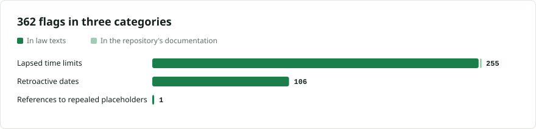

# Vulnerabilities in Kyrgyz law

[Русский](README.md) · **English**

<picture>
<source media="(prefers-color-scheme: dark)" srcset="img/flags-by-category-dark.svg">

</picture>

The vulnerability detectors from [lexifina/global-law](https://github.com/lexifina/global-law/tree/main/vulnerabilities) look for mechanical mistakes in legislation: a rule applying "until" a date that has passed, an act in force before it was published, a time limit extended only after it had run out, a reference to an article that no longer exists. global-law's published list (9 November 2026) covered Kyrgyzstan from an earlier commit of this repository and raised two flags, both judged not to be mistakes: a repeal gap in the closing signature line of the 1993 Constitution and a retroactive date for the law that put the 2010 Constitution into effect. This is a run over this repository only, as it stood at commit [`a26a8c2`](https://github.com/lexifina/kyrgyzstan-law/commit/a26a8c262f9e436ff6830d83d12e224e62c9d4bc) on 16 November 2026: the 1993 Constitution with its history, the 2021 Constitution, and 2,938 codes and laws in force (22 codes, 56 constitutional laws and 2,860 laws), each as its current text.

**In short:** the detectors raised 362 flags. A language model reviewed 80 of the strongest, arguing each one for and against; 5 survived. Checked by hand in this repository, none is a drafting mistake in Kyrgyz law. Three are spent rules written by amending laws: the deadline of 31 December 2016 by which advocates were to bring the form of their practice into line with the Law on the Bar (Law No. 147 of 27 July 2016), and two steps of a schedule of social insurance contribution rates that rises year by year to a final rate that applies "и далее" (Law No. 60 of 19 March 2015). Two come from how this repository dates acts: Law No. 207 of 31 December 2012 takes effect on publication and was published on 11 January 2013, but is dated on the date it bears; Law No. 253 of 6 November 2025 on customs regulation takes effect when a protocol to the Treaty on the Customs Code of the Eurasian Economic Union does, a day this record does not hold, and is dated the same way. The hand check also found that this repository dates 425 codes and laws by the date they bear because no commencement day was read, 59 of them against a day their own text or commit gives, and 112 laws by their day of publication although they take effect a set time later; and that it holds four laws twice. Later, this will be formalised in Lean, similar to our work on [the US tax code](https://lexifina.com/blog/formalizing-the-us-tax-code) and [US case law](https://lexifina.com/blog/formalizing-all-us-case-law-in-lean).

A flag is a prompt to look, not legal advice, and nothing here has been tested in court.

## Flags by category

| Category | What it looks for | Flags | In law texts | Reviewed | Survived review |
| --- | --- | ---: | ---: | ---: | ---: |
| Lapsed time limits | Text still applying a rule "until" a date that has passed | 255 | 253 | 40 | 3 |
| Retroactive or pre-publication dates | An act in force before it was published | 106 | 106 | 40 | 2 |
| References to repealed placeholders | A provision citing an article that now reads only as repealed | 1 | 1 | 0 | 0 |

"In law texts" counts all the law this repository holds: the Constitutions, the codes, the constitutional laws and the laws. The two other flags are in this repository's English README and in `REPRODUCE-acts.md`. Apart from the Constitutions, every act here has one version, its current text, in one commit: 2,440 were never amended, and the 498 amended ones begin on 3 November 2026, the day their text was fetched. So the search for repeal gaps, same-day conflicts, empty periods, stale amounts and references to deleted provisions found nothing to compare, and the repeal gap in global-law's list is gone: the change that removed the 1993 Constitution's signature line in 1996 is credited to the database with no law named (`Kind: unexplained`), which this run does not count as law. Nor did the search for dead currencies (amounts are in soms; no amount is in rubles) or for duplicate numbering find anything. In Russian "до" means both "until" and "before", so many lapsed time limits are cut-off dates ("поступившие до 1 июля 2017 года"), not limits. The search for lapsed time limits reads "до", "по" and, since a fix for this repository, "не позднее" before a date with the month in words or in figures; in the law texts it misses 11 phrases with a past year: 10 "до" before a bare year ("до 2010 года"), which mostly mark a period rather than a deadline, and one "до июня 1999 года".

*Edge cases: the 5 flags that survived the review, grouped by what they turned out to be, and what the other flags are, in [EDGE-CASES.en.md](EDGE-CASES.en.md).*

## Problems found in this repository

- **Commencement days not read:** 425 codes and laws are dated by the date they bear (the day the law was signed), because, as each commit message says, no commencement day was read. For 29 of them the act's own last article names an earlier day: Law No. 165 of 24 July 2008 says "Настоящий Закон вступает в силу с 1 января 2004 года" and is dated 24 July 2008 ([the commit](https://github.com/lexifina/kyrgyzstan-law/commit/2ad4bbada1e260d0ef15cf451a90d5294e71c307)). For 30 it names a later day that the commit itself makes known: the act takes effect on publication or a set time after it, or three months after signing, and the commit's `Published:` trailer gives the day of publication, so the record shows these acts in force before they were. Law No. 207 of 31 December 2012 takes effect "со дня официального опубликования", was published on 11 January 2013 and is dated 31 December 2012 ([the commit](https://github.com/lexifina/kyrgyzstan-law/commit/a34b54bda98adc39462049baf9c884a247855db9)); Law No. 206 of 11 July 2009 takes effect three months after signing and is dated on the day of signing ([the commit](https://github.com/lexifina/kyrgyzstan-law/commit/16c7a36aa661d253d54594c8f7180cc639f7e1cf)). Of the rest, 200 take effect on or after publication with no day of publication in the record, and 101 on signing, which the date they bear gives rightly.
- **A set time after publication read as publication:** 112 laws that take effect a set time after publication ("по истечении 10 дней", "по истечении шести месяцев со дня официального опубликования") are dated on the day of publication, which their commit messages give as the reason ("on publication"). Law No. 100 of 18 June 2024 takes effect six months after publication and is dated 21 June 2024, its day of publication ([the commit](https://github.com/lexifina/kyrgyzstan-law/commit/704dbd405c4dedec5e0d08f747296d737bcaac94)). The commit messages read such periods when the number of days is written in words ("десяти", "пятнадцати"); the 112 mostly give the number in figures or count months.
- **Database days before the law was signed:** three laws are dated by the database's entry-into-force day, which falls before the law was signed: Law No. 62 of 17 March 2023 (copyright) on 8 April 2022, Law No. 71 of 27 March 2023 (civil protection) on 14 March 2023 and Law No. 50 of 3 March 2023 (a ratification) on 17 February 2023. Each takes effect fifteen or ten days after publication, and was published on 24 March, 4 April and 7 March 2023, so the database's day looks a year or a month off ([the first commit](https://github.com/lexifina/kyrgyzstan-law/commit/efe5925303512f7d3fedc13ab2ef7546051cb724)).
- **Four laws held twice:** Law No. 61 of 21 June 2018, Laws No. 62 and No. 64 of 25 March 2025 and Law No. 69 of 19 May 2026 each have two folders from two database entries, such as [`zakon/2025/03-25-n62`](https://github.com/lexifina/kyrgyzstan-law/tree/a26a8c262f9e436ff6830d83d12e224e62c9d4bc/zakon/2025/03-25-n62) and [`zakon/2025/03-25-n62-d230024791`](https://github.com/lexifina/kyrgyzstan-law/tree/a26a8c262f9e436ff6830d83d12e224e62c9d4bc/zakon/2025/03-25-n62-d230024791), with the same articles apart from the closing lines (the publication note, the President's signature, the day of adoption). The two copies are not always dated alike: the second copies of the 2025 laws are dated 25 March 2025 (the database's day), the first ones 28 March 2025, the day of publication on which they take effect; one copy of the 2018 law is dated 18 July 2018, the other 21 June 2018.

## Files

| File | What it holds |
| --- | --- |
| [data/flags.csv](data/flags.csv) | Every flag, one row per article or act and issue |
| [data/reviewed.csv](data/reviewed.csv) | The 80 flags the model reviewed, with its verdict and reason |
| [data/by_category.csv](data/by_category.csv) | The counts in the table above |
| [tools/](tools/) | The scripts that made this run |

Columns: `category` and `category_ru` (the category in English and Russian), `detector`, `kind` (`law` or `other`), `path` (the file in this repository; for retroactive dates, the first file of the act), `date` (the date the flag turns on), `reference` (the act or line involved), `summary`, `score` (the detector's ranking, 0 to 1), `review` (`artefact`, `lawful` or `candidate_defect`), `survives_rebuttal`, `review_note` (the model's reason, in English), `url` (the article at the commit that was read, or, for retroactive dates, the act's commit).

## How it was made

- **Detectors:** global-law's [vulnerabilities/scripts](https://github.com/lexifina/global-law/tree/main/vulnerabilities/scripts), with the fixes in [tools/patch_detectors.py](tools/patch_detectors.py) and the other patches in [tools/](tools/README.md), run on this repository at commit `a26a8c2`. The history table the detectors read was built from this repository's own commits (the author, the act that made each change, and the `In-force` and `Kind` trailers), counting as law the kinds `law`, `publisher` (the current text of the amended codes and laws) and `Закон` and `Конституция` (the Constitutions' history): 2,949 commits. Paths from before the folder move of 10 November 2026 are mapped to each act's folder today through `data/paths.json`. Fixes made for this repository ([tools/](tools/README.md)): the search for time limits now reads "не позднее" before a date (11 flags); the reference scan reads the articles of this repository (`statya-012.md`, `statya-131-1.md`), the cases of "статья" ("статье", "статьей", "статьями") and article numbers such as 131-1, and no longer takes "статьи 5 Закона ..." or "статьей 12 Налогового кодекса" for the act's own article; and the search for references to repealed articles no longer takes "за исключением" (except) for "исключена" (deleted), which removed 6 of its 7 flags.
- **Model review:** gpt-5.4-mini, the 40 strongest flags per category, and for lapsed time limits also the 40 strongest in law texts (here the same 40); one pass says whether a flag is real, a second argues that it is not. Where a flag was reviewed twice, the later review is kept. There were no empty periods to review, and the model does not review references to repealed placeholders. global-law's own list used a different model.
- **Hand check:** every case that survived was read in this repository's texts and commits, with the amended law where the repository holds it; none is left open. The other flags were read by category. Whether the customs protocol named by Law No. 253 of 2025 has taken effect needs an official source.

To report a correction, open an issue with the provision and an official source.

## Licence

The lists and notes are Lexifina's, dedicated to the public domain under CC0 1.0, like the rest of this repository's own contributions. Quoted law text is as the Centralised Database of Legal Information of the Ministry of Justice publishes it; official documents (laws, decisions and the like) are not objects of copyright in Kyrgyzstan (Закон Кыргызской Республики "Об авторском праве и смежных правах", статья 8). See [LICENSE](../LICENSE).
