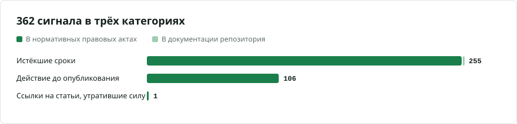

# Уязвимости в законодательстве Кыргызстана

**Русский** · [English](README.en.md)

<picture>
<source media="(prefers-color-scheme: dark)" srcset="img/flags-by-category-dark.ru.svg">

</picture>

Детекторы уязвимостей из репозитория [lexifina/global-law](https://github.com/lexifina/global-law/tree/main/vulnerabilities) ищут механические ошибки в законодательстве: норму, которая всё ещё действует «до» уже прошедшей даты, акт, вступивший в силу до его опубликования, срок, продлённый лишь после того, как он истёк, ссылку на статью, которой больше нет. Перечень, опубликованный global-law 9 ноября 2026 года, охватывал Кыргызстан по более раннему коммиту этого репозитория и содержал два сигнала, ни один из которых не был признан ошибкой: пробел после отмены в заключительной строке с подписью Конституции 1993 года и вступление в силу до опубликования закона о введении в действие Конституции 2010 года. Здесь проверен только этот репозиторий в состоянии на коммит [`a26a8c2`](https://github.com/lexifina/kyrgyzstan-law/commit/a26a8c262f9e436ff6830d83d12e224e62c9d4bc) от 16 ноября 2026 года: Конституция 1993 года с историей её изменений, Конституция 2021 года и 2 938 действующих кодексов и законов (22 кодекса, 56 конституционных законов и 2 860 законов), каждый в текущей редакции.

**Коротко:** детекторы выдали 362 сигнала. Языковая модель рассмотрела 80 самых сильных, приводя по каждому доводы за и против; 5 из них устояли. После ручной проверки в этом репозитории ни один не оказался ошибкой в законодательстве Кыргызстана. Три — исчерпавшие себя нормы, внесённые изменяющими законами: срок до 31 декабря 2016 года, в который адвокаты должны были привести форму организации своей деятельности в соответствие с Законом об адвокатуре (Закон от 27 июля 2016 года № 147), и две ступени шкалы тарифов страховых взносов, которая год за годом повышается до окончательного тарифа, применяемого «и далее» (Закон от 19 марта 2015 года № 60). Два объясняются тем, как этот репозиторий датирует акты: Закон от 31 декабря 2012 года № 207 вступает в силу со дня официального опубликования и опубликован 11 января 2013 года, но датирован днём, которым датирован сам закон; Закон от 6 ноября 2025 года № 253 по вопросам таможенного регулирования вступает в силу со дня вступления в силу протокола к Договору о Таможенном кодексе Евразийского экономического союза, а этого дня в записи нет, поэтому он датирован так же. Кроме того, проверка показала, что этот репозиторий датирует 425 кодексов и законов днём, которым датирован сам акт, потому что день вступления в силу не был прочитан, причём у 59 из них другой день называет их собственный текст или коммит, а 112 законов — днём опубликования, хотя они вступают в силу по истечении определённого срока; и что четыре закона хранятся в нём дважды. В дальнейшем это будет формализовано в Lean, по образцу нашей работы над [налоговым кодексом США](https://lexifina.com/blog/formalizing-the-us-tax-code) и [судебной практикой США](https://lexifina.com/blog/formalizing-all-us-case-law-in-lean).

Сигнал — это повод присмотреться, а не юридическая консультация; ничто из изложенного здесь не проверялось в суде.

## Сигналы по категориям

| Категория | Что ищет | Сигналы | В нормативных правовых актах | Рассмотрены | Устояли после рассмотрения |
| --- | --- | ---: | ---: | ---: | ---: |
| Истёкшие сроки | Текст, по-прежнему применяющий норму «до» даты, которая уже прошла | 255 | 253 | 40 | 3 |
| Вступление в силу до опубликования | Акт, вступивший в силу до того, как он был опубликован | 106 | 106 | 40 | 2 |
| Ссылки на статьи, утратившие силу | Норма, ссылающаяся на статью, от которой осталась лишь отметка об утрате силы | 1 | 1 | 0 | 0 |

«В нормативных правовых актах» учитывает всё законодательство, которое содержит этот репозиторий: Конституции, кодексы, конституционные законы и законы. Два остальных сигнала находятся в английском README репозитория и в `REPRODUCE-acts.md`. Кроме Конституций, каждый акт представлен здесь одной редакцией, текущей, в одном коммите: 2 440 ни разу не изменялись, а 498 изменённых начинаются с 3 ноября 2026 года, дня получения их текста. Поэтому поиск пробелов после отмены, изменений в один день, пустых периодов, устаревших сумм и ссылок на исключённые нормы ничего не нашёл: сравнивать нечего. По той же причине пропал и пробел после отмены из перечня global-law: изменение 1996 года, которым из Конституции 1993 года была исключена строка с подписью, приписано базе данных без указания закона (`Kind: unexplained`), а такие коммиты в этой проверке законодательством не считаются. Ничего не нашёл и поиск вышедших из обращения валют (суммы указаны в сомах, ни одной суммы в рублях нет) и двойной нумерации. Предлог «до» означает и «вплоть до», и «ранее», поэтому многие истёкшие сроки — это лишь граничные даты («поступившие до 1 июля 2017 года»), а не сроки действия. Поиск истёкших сроков читает «до», «по» и, после исправления, сделанного для этого репозитория, «не позднее» перед датой с месяцем, написанным словом или цифрами; в нормативных правовых актах он пропускает 11 выражений с прошедшим годом: 10 раз «до» перед одним лишь годом («до 2010 года»), что чаще обозначает период, чем срок, и один раз «до июня 1999 года».

*Пограничные случаи: 5 сигналов, устоявших после рассмотрения, сгруппированные по тому, чем они оказались, и что представляют собой остальные сигналы, — в [EDGE-CASES.md](EDGE-CASES.md).*

## Проблемы, обнаруженные в этом репозитории

- **Не прочитан день вступления в силу:** 425 кодексов и законов датированы днём, которым датирован сам акт (днём подписания закона), потому что, как сказано в сообщении каждого коммита, день вступления в силу не был прочитан. У 29 из них собственная заключительная статья называет более ранний день: Закон от 24 июля 2008 года № 165 гласит «Настоящий Закон вступает в силу с 1 января 2004 года», а датирован 24 июля 2008 года ([коммит](https://github.com/lexifina/kyrgyzstan-law/commit/2ad4bbada1e260d0ef15cf451a90d5294e71c307)). У 30 она называет более поздний день, который виден из самого коммита: акт вступает в силу со дня официального опубликования, по истечении определённого срока после него или через три месяца после подписания, а трейлер коммита `Published:` указывает день опубликования, так что запись показывает эти акты действующими раньше, чем они вступили в силу. Закон от 31 декабря 2012 года № 207 вступает в силу «со дня официального опубликования», опубликован 11 января 2013 года, а датирован 31 декабря 2012 года ([коммит](https://github.com/lexifina/kyrgyzstan-law/commit/a34b54bda98adc39462049baf9c884a247855db9)); Закон от 11 июля 2009 года № 206 вступает в силу по истечении трёх месяцев со дня подписания, а датирован днём подписания ([коммит](https://github.com/lexifina/kyrgyzstan-law/commit/16c7a36aa661d253d54594c8f7180cc639f7e1cf)). Из остальных 200 вступают в силу со дня опубликования или позднее, но дня опубликования в записи нет, а 101 — со дня подписания, и дата самого акта для них верна.
- **Срок после опубликования прочитан как день опубликования:** 112 законов, вступающих в силу по истечении определённого срока после опубликования («по истечении 10 дней», «по истечении шести месяцев со дня официального опубликования»), датированы днём опубликования, и сообщения их коммитов называют именно его («on publication»). Закон от 18 июня 2024 года № 100 вступает в силу по истечении шести месяцев со дня официального опубликования, а датирован 21 июня 2024 года, днём опубликования ([коммит](https://github.com/lexifina/kyrgyzstan-law/commit/704dbd405c4dedec5e0d08f747296d737bcaac94)). Сообщения коммитов учитывают такой срок, когда число дней написано словом («десяти», «пятнадцати»); у этих 112 законов оно в основном написано цифрами или срок исчисляется месяцами.
- **Дни базы данных раньше подписания закона:** три закона датированы днём вступления в силу по базе данных, который приходится на время до подписания закона: Закон от 17 марта 2023 года № 62 (об авторском праве) — 8 апреля 2022 года, Закон от 27 марта 2023 года № 71 (о гражданской защите) — 14 марта 2023 года, Закон от 3 марта 2023 года № 50 (о ратификации) — 17 февраля 2023 года. Каждый из них вступает в силу по истечении пятнадцати или десяти дней со дня официального опубликования, а опубликованы они 24 марта, 4 апреля и 7 марта 2023 года, так что день в базе данных, по-видимому, сдвинут на год или на месяц ([первый коммит](https://github.com/lexifina/kyrgyzstan-law/commit/efe5925303512f7d3fedc13ab2ef7546051cb724)).
- **Четыре закона хранятся дважды:** Закон от 21 июня 2018 года № 61, Законы от 25 марта 2025 года № 62 и № 64 и Закон от 19 мая 2026 года № 69 имеют по две папки из двух записей базы данных, например [`zakon/2025/03-25-n62`](https://github.com/lexifina/kyrgyzstan-law/tree/a26a8c262f9e436ff6830d83d12e224e62c9d4bc/zakon/2025/03-25-n62) и [`zakon/2025/03-25-n62-d230024791`](https://github.com/lexifina/kyrgyzstan-law/tree/a26a8c262f9e436ff6830d83d12e224e62c9d4bc/zakon/2025/03-25-n62-d230024791), с одинаковыми статьями, кроме заключительных строк (отметки об опубликовании, подписи Президента, дня принятия). Датированы эти копии не всегда одинаково: вторые копии законов 2025 года — 25 марта 2025 года (день по базе данных), первые — 28 марта 2025 года, днём опубликования, с которого они вступают в силу; одна копия закона 2018 года датирована 18 июля 2018 года, другая — 21 июня 2018 года.

## Файлы

| Файл | Что содержит |
| --- | --- |
| [data/flags.csv](data/flags.csv) | Все сигналы, по одной строке на статью или акт и проблему |
| [data/reviewed.csv](data/reviewed.csv) | 80 сигналов, рассмотренных моделью, с её оценкой и обоснованием |
| [data/by_category.csv](data/by_category.csv) | Числа из таблицы выше |
| [tools/](tools/) | Скрипты, с помощью которых выполнена проверка |

Столбцы: `category` и `category_ru` (категория на английском и на русском), `detector`, `kind` (`law` или `other`), `path` (файл в этом репозитории; для вступления в силу до опубликования — первый файл акта), `date` (дата, к которой относится сигнал), `reference` (затронутый акт или строка), `summary`, `score` (оценка детектора, от 0 до 1), `review` (`artefact`, `lawful` или `candidate_defect`), `survives_rebuttal`, `review_note` (обоснование модели, на английском), `url` (статья в прочитанном коммите, а для вступления в силу до опубликования — коммит акта).

## Как это сделано

- **Детекторы:** [vulnerabilities/scripts](https://github.com/lexifina/global-law/tree/main/vulnerabilities/scripts) из global-law с исправлениями из [tools/patch_detectors.py](tools/patch_detectors.py) и другими исправлениями из [tools/](tools/README.md), запущенные на этом репозитории по коммиту `a26a8c2`. Таблица истории, которую читают детекторы, построена по собственным коммитам репозитория (автор, то есть акт, внёсший каждое изменение, и трейлеры `In-force` и `Kind`); законодательством считаются коммиты видов `law`, `publisher` (текущая редакция изменённых кодексов и законов), `Закон` и `Конституция` (история Конституций): 2 949 коммитов. Пути до переноса папок 10 ноября 2026 года сопоставлены с нынешними папками актов через `data/paths.json`. Исправления, сделанные для этого репозитория ([tools/](tools/README.md)): поиск сроков теперь читает «не позднее» перед датой (11 сигналов); поиск ссылок читает файлы статей этого репозитория (`statya-012.md`, `statya-131-1.md`), падежные формы слова «статья» («статье», «статьей», «статьями») и номера вида 131-1 и больше не принимает «статьи 5 Закона ...» или «статьей 12 Налогового кодекса» за статью того же акта; поиск ссылок на статьи, утратившие силу, больше не принимает «за исключением» за «исключена», что сняло 6 из 7 его сигналов.
- **Рассмотрение моделью:** gpt-5.4-mini, 40 самых сильных сигналов в каждой категории, а для истёкших сроков ещё и 40 самых сильных в нормативных правовых актах (здесь те же 40); первый проход оценивает, реален ли сигнал, второй доказывает, что нет. Если сигнал рассмотрен дважды, действует более позднее рассмотрение. Пустых периодов для рассмотрения не было, а ссылки на статьи, утратившие силу, модель не рассматривает. Собственный перечень global-law составлен другой моделью.
- **Ручная проверка:** каждый устоявший случай прочитан в текстах и коммитах этого репозитория вместе с изменённым законом, если репозиторий его содержит; открытых случаев не осталось. Остальные сигналы прочитаны по категориям. Вступил ли в силу таможенный протокол, названный в Законе от 6 ноября 2025 года № 253, нужно проверять по официальному источнику.

Чтобы сообщить об исправлении, откройте issue с указанием нормы и официального источника.

## Лицензия

Перечни и примечания принадлежат Lexifina и переданы в общественное достояние на условиях CC0 1.0, как и остальной собственный вклад в этот репозиторий. Цитируемый текст законодательства приводится в том виде, в каком его публикует Централизованный банк данных правовой информации Министерства юстиции; официальные документы (законы, решения и т. п.) не являются в Кыргызстане объектами авторского права (Закон Кыргызской Республики «Об авторском праве и смежных правах», статья 8). См. [LICENSE](../LICENSE).
